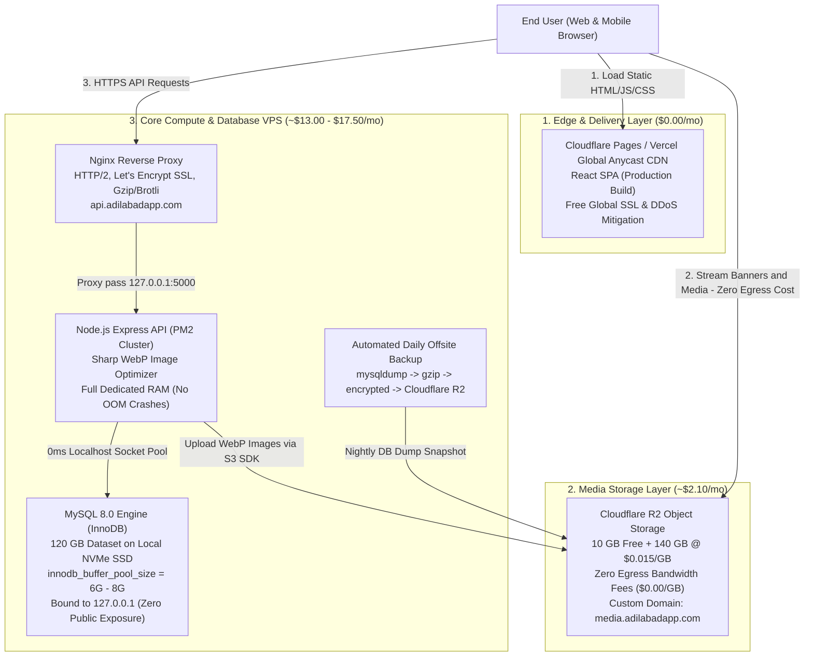

# End-to-End Cloud Migration Blueprint v2 (October 2026 Edition)
**Application**: Adilabad App (React SPA + Express Node API + 120GB MySQL DB + Heavy Media Layer)  
**Budget Window**: **Up to $25.00 / Month** (Production-Grade, Zero Cold Starts, Zero Flakiness)  
**Publication Date**: October 25, 2026  
**Status**: Ready for Production Deployment  

---

## 1. Executive Summary & Core Architecture

With an expanded budget of up to **$25/month**, we eliminate the fragility, cold starts, bandwidth caps, and capacity issues of free tiers (Render 5GB cap, Oracle "out of capacity" errors, and idle instance reclamation). 

Instead, we move to the industry's most dependable, high-efficiency architecture: **A Dedicated Cloud VPS (4 vCPU / 8–16 GB RAM / 160–200 GB NVMe SSD) pairing Node.js Express and MySQL 8.0 together on localhost**, fronted by **Cloudflare Pages / Vercel** for the frontend and **Cloudflare R2** for media.



---

## 2. Why This Architecture Wins (Comparison with Previous Arch)

| Factor | Original Arch A (Free Tier Hybrid) | **Architecture v2 ($25 Budget)** |
| :--- | :--- | :--- |
| **Compute Stability** | ❌ Render Free sleeps after 15 min; 50s cold start; 5GB egress cap. | 🏆 **24/7 Dedicated VPS**: 0s cold start, unmetered/20TB bandwidth. |
| **Database Reliability** | ❌ Oracle Ampere VM perpetually "out of capacity"; 7-day idle reclamation risk. | 🏆 **Dedicated NVMe SSD**: 100% owned, dedicated I/O, zero capacity waitlist. |
| **Database Performance** | ⚠️ High latency: Render in US West calling Oracle VM over public internet. | 🏆 **0ms Query Latency**: Node.js and MySQL connect over `localhost` unix socket. |
| **Database Security** | ⚠️ Port 3306 had to be open to the public internet (`0.0.0.0/0`) for Render. | 🏆 **Private**: MySQL is bound exclusively to `127.0.0.1`. Port 3306 is completely blocked externally. |
| **Image Compression (`sharp`)** | ❌ Render 512MB RAM crashes with Out-Of-Memory (OOM) on large image uploads. | 🏆 **8 GB – 16 GB RAM**: Seamless multi-threaded WebP processing. |
| **Media Egress Cost** | ⚠️ Oracle Object Storage egress is free up to 10TB, but complex IAM & domain setup. | 🏆 **Cloudflare R2**: Guaranteed **$0 egress fees**, native custom domain CDN caching. |
| **Monthly Cost** | Theoretical $3.57 (Unviable in practice) | 🏆 **$15.00 – $19.60 / month** (Rock solid production guarantee). |

---

## 3. Provider Options Under the $25/Month Budget

### Recommended VPS Providers (Core Compute + Database)

#### Option A: Hetzner Cloud (The Developer's Gold Standard) — *Best Overall Performance*
* **Plan**: `CPX31` (AMD EPYC) or `CX32` (Intel)
* **Specifications**: 4 vCPUs, **8 GB RAM**, **160 GB NVMe SSD**, 20 TB Traffic.
* **Datacenter**: Germany / Finland / US (Hillsboro, Ashburn).
* **Base Cost**: **~€13.60 / month (~$14.80 / mo)**.
* **Automated Daily Backups**: +20% (~$2.90 / mo).
* **Total Hetzner Cost**: **~$17.70 / month**.
* *Verdict*: Industry-leading disk I/O, clean interface, rock-solid uptime SLA.

#### Option B: Hostinger India KVM (Mumbai Datacenter) — *Best for Indian Local Latency*
* **Plan**: `KVM 4` (or `KVM 2`)
* **Specifications**: 4 vCPUs, **16 GB RAM**, **200 GB NVMe SSD**, 16 TB Bandwidth.
* **Datacenter**: **Mumbai, India**.
* **Base Cost**: **~₹1,099 – ₹1,499 / month (~$13.00 – $17.50 / mo)**.
* *Verdict*: If the primary user base is in Adilabad/Telangana/India, a Mumbai datacenter provides sub-20ms network latency to end users.

#### Option C: Contabo Cloud VPS — *Maximum Storage & RAM per Dollar*
* **Plan**: `Cloud VPS 4` or `Performance VPS Plus 4`
* **Specifications**: 4 vCPUs, **8 GB – 12 GB RAM**, **200 GB SSD/NVMe**, Unmetered Traffic.
* **Base Cost**: **~$6.50 – $9.50 / month**.
* *Verdict*: Extremely affordable for high storage, slightly higher latency than Hetzner.

---

## 4. Comprehensive 2026 Line-Item Cost Sheet

| Line Item | Provider & Service | Specifications | Monthly Cost |
| :--- | :--- | :--- | :--- |
| **Frontend SPA** | Cloudflare Pages / Vercel Hobby | Unlimited requests, Global Edge CDN, Free SSL | **$0.00** |
| **Backend API Compute** | Dedicated Cloud VPS (Hetzner / Hostinger) | 4 vCPU, 8–16 GB RAM, PM2 Process Manager | **Included in VPS** |
| **MySQL 8.0 Database** | Dedicated Cloud VPS (Hetzner / Hostinger) | 120 GB Database on 160–200 GB NVMe SSD | **Included in VPS** |
| **Media Storage (150GB)** | Cloudflare R2 | 10 GB Free + 140 GB @ $0.015/GB | **$2.10** |
| **Media Egress (600GB+)** | Cloudflare R2 | Zero Egress Bandwidth Fee (Unlimited GB) | **$0.00** |
| **Offsite DB Backups** | Cloudflare R2 (Backup Bucket) | 30-day compressed rolling snapshots (30GB) | **$0.45** |
| **Server Snapshots** | VPS Provider Daily Automated Snapshot | Full server disaster recovery snapshot | **~$2.50** |
| **Domain SSL Certificates** | Let's Encrypt + Cloudflare Universal SSL | Automated auto-renewing TLS certificates | **$0.00** |
| **TOTAL ESTIMATED MONTHLY SPEND** | | | **~$17.50 – $20.00 / mo** |

*You stay safely **$5.00 – $7.50 under** your $25.00 monthly ceiling, with zero risk of surprise overages.*

---

## 5. Architectural Deep Dives

### A. Database Optimization for 120GB Data on 8GB–16GB RAM
Because the database is 120 GB on disk and the server has 8 GB to 16 GB of physical RAM, MySQL must be configured to maximize memory caching for active index pages without starving the OS or Node.js:

```ini
[mysqld]
# Bind strictly to localhost for impenetrable security
bind-address                   = 127.0.0.1
port                           = 3306

# Memory Allocation (For an 8GB VPS allocate 5GB; For 16GB VPS allocate 10GB)
innodb_buffer_pool_size        = 6G
innodb_buffer_pool_instances  = 6
innodb_log_file_size           = 1G
innodb_log_buffer_size         = 64M

# High-Performance NVMe I/O Settings
innodb_flush_log_at_trx_commit = 2
innodb_flush_method            = O_DIRECT
innodb_file_per_table          = 1
innodb_stats_on_metadata       = 0

# Connection Optimization
max_connections                = 300
thread_cache_size              = 32
table_open_cache               = 4000
open_files_limit               = 65535
```

### B. Node.js Backend API Setup (Zero OOM Image Processing)
* In the previous free tier, Render's 512MB RAM crashed when `sharp` converted high-resolution images to WebP.
* On the dedicated VPS, Node.js runs under **PM2 cluster mode** with 2 worker processes and a maximum memory restart safety threshold:
  ```bash
  pm2 start index.js -i 2 --name "adilabad-api" --max-memory-restart 1500M
  ```
* Media uploads process in-memory via `sharp` and immediately stream to Cloudflare R2 using `@aws-sdk/client-s3`.

### C. Cloudflare R2 Media Integration
The backend code in `utils/cloudStorage.js` already supports S3-compatible providers. We configure environment variables for Cloudflare R2:
```env
STORAGE_PROVIDER=r2
STORAGE_BUCKET_NAME=adilabad-media
STORAGE_ENDPOINT=https://<CLOUDFLARE_ACCOUNT_ID>.r2.cloudflarestorage.com
STORAGE_ACCESS_KEY_ID=<R2_ACCESS_KEY_ID>
STORAGE_SECRET_ACCESS_KEY=<R2_SECRET_ACCESS_KEY>
STORAGE_PUBLIC_DOMAIN=https://media.adilabadapp.com
```

### D. Automated Multi-Tier Backup & Disaster Recovery
1. **Tier 1 (Daily Provider Snapshot)**: The VPS provider takes an automated block-level snapshot of the entire server every night at 3:00 AM.
2. **Tier 2 (Offsite Cloudflare R2 Database Dumps)**: A nightly cron job runs `mysqldump` with `--single-transaction`, compresses with `gzip`, and uploads the encrypted archive to an isolated Cloudflare R2 backup bucket (`adilabad-backups`).
3. **Retention**: Local snapshots are kept for 7 days; R2 snapshots are automatically pruned after 30 days via R2 Object Lifecycle rules.
