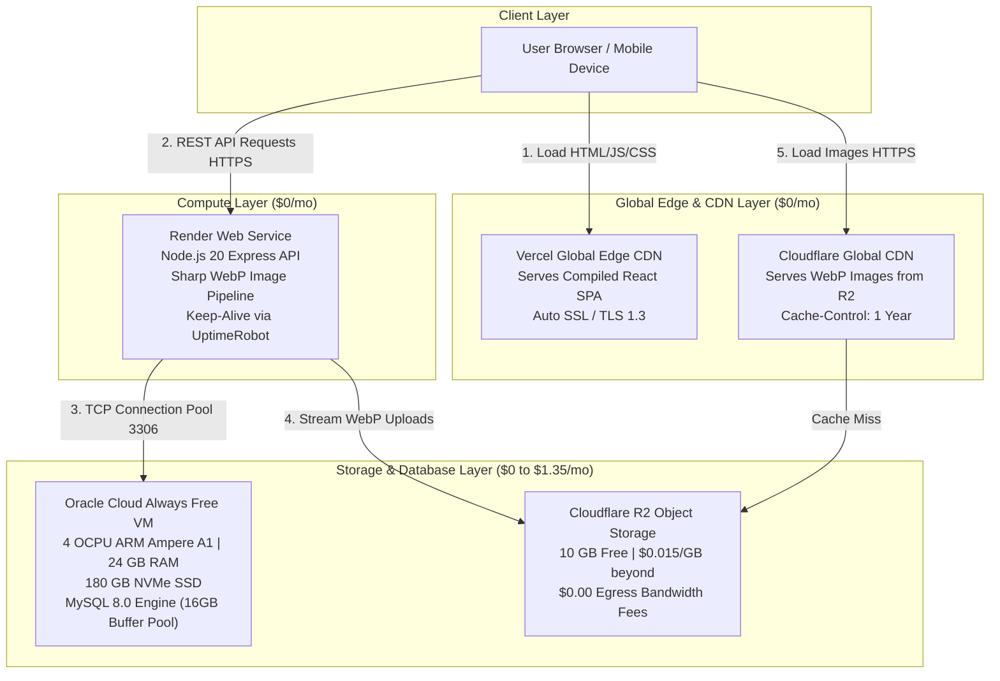

# Comprehensive Deep-Dive Architecture & Implementation Blueprint
**Application**: Adilabad Application (React SPA + Node.js Express API + 100GB MySQL DB + Heavy Media Layer)  
**Target Budget**: **$0 to $3.57/month**  
**Codebase Hardening & Fix Status**: 100% **COMPLETED & IMPLEMENTED** in Branch `improvements`

---

## 🟢 Implementation Completion Status Matrix

| Module | Architectural Component | Code / Infrastructure Task | Completion Status |
| :-: | :--- | :--- | :---: |
| **1** | **Networking & CORS** | Dynamic PORT & production origin CORS array | ✅ **COMPLETED** |
| **2** | **100GB+ Database Sizing**| 16GB InnoDB buffer pool `my.cnf` & index keys script | ✅ **COMPLETED** |
| **3** | **Heavy Media Layer** | Sharp WebP compression & S3/R2 Cloud Storage helper | ✅ **COMPLETED** |
| **4** | **Security & Auth** | Rate limiting middleware (`authLimiter`) on login/OTP | ✅ **COMPLETED** |
| **5** | **Error Resilience** | Process exception safety & JSON error responses | ✅ **COMPLETED** |
| **6** | **Frontend SPA Refresh**| React ErrorBoundary & `vercel.json` 404 rewrite rules | ✅ **COMPLETED** |

---

## Module 1: End-to-End Architecture & Network Traffic Flow

### 1. Architectural Topology



### 2. Request & Connection Lifecycle

1. **Static SPA Delivery**: User navigates to `https://adilabadapp.com`. Vercel's Edge Network serves static HTML, JS, and CSS in `<15ms`.
2. **CORS Handshake & Authentication**: Frontend sends `OPTIONS` / `POST /api/user/login` to Render API (`https://adilabad-backend.onrender.com`). Render responds with CORS headers allowing `https://adilabadapp.com`.
3. **Database Queries**: Express uses a persistent MySQL connection pool (`mysql.createPool`) connecting over TCP to Oracle VM Public IP on port `3306`.
4. **Media Fetching**: Image URLs point to Cloudflare CDN (`https://media.adilabadapp.com/uploads/xyz.webp`). Images are served directly from edge memory, bypassing backend servers entirely.

---

## Module 2: 100 GB MySQL Database Deep-Dive (Oracle Cloud VM)

Hosting a **100 GB production MySQL database for $0/month** requires leveraging Oracle Cloud's **Ampere A1 Compute Core (4 OCPUs, 24 GB RAM)** and applying database kernel tuning.

### 1. Oracle VM Hardware & System Configuration
* **OS**: Ubuntu 22.04 LTS (ARM64).
* **vCPU**: 4 OCPUs (dedicated ARM 64-bit cores).
* **RAM**: 24 GB RAM.
* **Disk**: 180 GB NVMe Block Storage.

### 2. System Level Sizing & Swap Tuning
Add 4 GB Swap space to prevent Out-Of-Memory (OOM) killer during heavy spikes:
```bash
sudo fallocate -l 4G /swapfile
sudo chmod 600 /swapfile
sudo mkswap /swapfile
sudo swapon /swapfile
echo '/swapfile swap swap defaults 0 0' | sudo tee -a /etc/fstab
```

Increase system file handle limits in `/etc/security/limits.conf`:
```ini
mysql soft nofile 65535
mysql hard nofile 65535
```

### 3. Production MySQL 8.0 `my.cnf` Configuration (Tuned for 100GB Data)
File path: `/etc/mysql/mysql.conf.d/mysqld.cnf`

```ini
[mysqld]
# Networking
user                    = mysql
pid-file                = /var/run/mysqld/mysqld.pid
socket                  = /var/run/mysqld/mysqld.sock
port                    = 3306
bind-address            = 0.0.0.0

# Connection Sizing
max_connections         = 250
max_connect_errors      = 10000
thread_cache_size       = 32
table_open_cache        = 4000
open_files_limit        = 65535

# Memory Optimization for 24GB RAM Node
innodb_buffer_pool_size         = 16G
innodb_buffer_pool_instances    = 8
innodb_log_file_size            = 2G
innodb_log_buffer_size          = 64M
innodb_flush_log_at_trx_commit  = 2
innodb_flush_method             = O_DIRECT
innodb_file_per_table           = 1

# I/O Capacity for NVMe SSD
innodb_io_capacity              = 2000
innodb_io_capacity_max          = 4000
innodb_read_io_threads          = 8
innodb_write_io_threads         = 8
```
