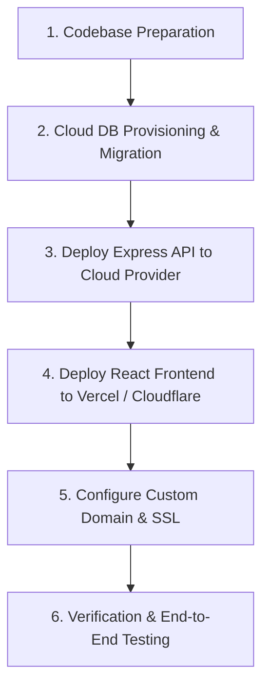

# Implementation Plan: Adilabad App Cloud Migration (100GB DB Ready)

This plan details the end-to-end migration of the **Adilabad App** (React SPA Frontend + Express Node Backend + 100GB MySQL Database + Uploads) to a **100% Permanently Free Cloud Infrastructure**.

---

## Key Architecture Highlights

1. **Database Layer (Oracle Cloud Always Free)**: 4 ARM vCPUs, 24 GB RAM, and 200 GB SSD storage (100% free forever) hosting self-hosted MySQL 8.0 tuned with 16GB `innodb_buffer_pool_size`.
2. **Backend Layer (Render Web Service)**: Hosted Node.js/Express API with CORS and dynamic PORT binding. Keep-alive pings via UptimeRobot (Free) prevent sleep state.
3. **Frontend Layer (Vercel Global CDN)**: High-speed React SPA distribution with auto SSL.
4. **Media Layer (Cloudflare R2 / Oracle Object Storage)**: 10 GB free object storage with zero egress fees for image banners and product media.

---

## Proposed Changes

### Backend Component (`AdilabadBackEnd`)

#### [MODIFY] [index.js](file:///Users/sagarpabba/SourceCode_Adilabad/Backend/AdilabadBackEnd/index.js)
- Bind server port to `process.env.PORT || 5000`.
- Update CORS middleware to support production origins dynamically.

#### [NEW] [utils/cloudStorage.js](file:///Users/sagarpabba/SourceCode_Adilabad/Backend/AdilabadBackEnd/utils/cloudStorage.js)
- Sharp WebP image processing & S3-compatible cloud storage handler.

#### [NEW] [Dockerfile](file:///Users/sagarpabba/SourceCode_Adilabad/Backend/AdilabadBackEnd/Dockerfile)
- Create lightweight Alpine Node container for automated containerized deployment.

#### [NEW] [.dockerignore](file:///Users/sagarpabba/SourceCode_Adilabad/Backend/AdilabadBackEnd/.dockerignore)
- Exclude `node_modules`, `uploads`, `.env`, and backup files from Docker contexts.

---

### Frontend Component (`AdilabadFrontEnd`)

#### [MODIFY] [src/config.js](file:///Users/sagarpabba/SourceCode_Adilabad/Frontend/AdilabadFrontEnd/src/config.js)
- Support environment variables `process.env.REACT_APP_API_URL` and `process.env.REACT_APP_FRONTEND_URL`.

#### [NEW] [.env.production](file:///Users/sagarpabba/SourceCode_Adilabad/Frontend/AdilabadFrontEnd/.env.production)
- Add production environment variable defaults for build pipeline.

---

## Migration Flow

