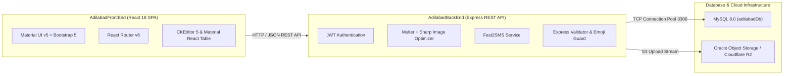
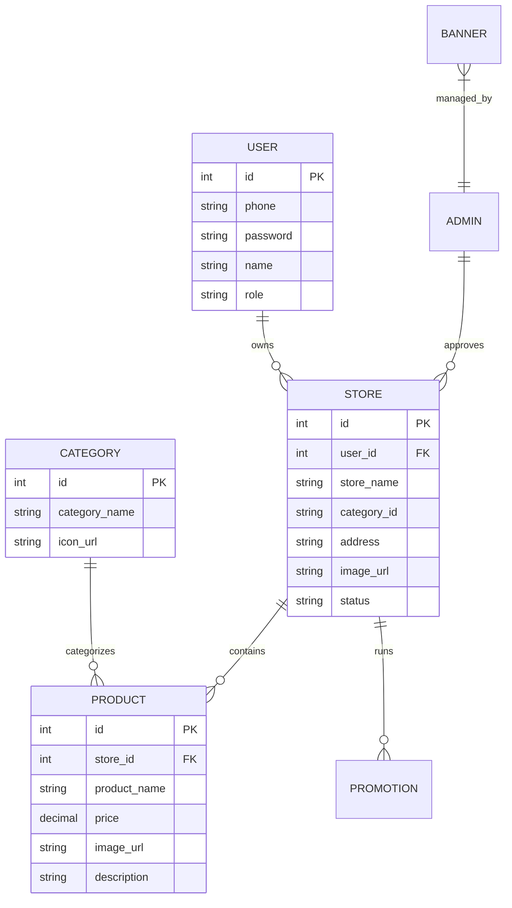

# Complete Project Architecture & Codebase Overview
**Project Name**: Adilabad Application  
**Repositories**: `AdilabadBackEnd` (Node.js/Express) & `AdilabadFrontEnd` (React 18 SPA)

---

## 1. Project Purpose & System Domain

The **Adilabad Application** is a full-stack local e-commerce, merchant directory, and marketplace platform serving the Adilabad region. It allows local merchants/stores to showcase products, run promotional banners, manage store categories, handle user registrations, and process customer inquiries.

---

## 2. Overall Technology Stack



---

## 3. Backend Architecture (`AdilabadBackEnd`)

### Technology Stack
* **Runtime**: Node.js 20+
* **Web Framework**: Express v4.19
* **Database Driver**: `mysql` v2.18 (pooled connection architecture)
* **Security & Auth**: `jsonwebtoken` v9.0, `bcryptjs` v2.4
* **File Uploads & Image Processing**: `multer` v1.4, `sharp` v0.33 (WebP conversion), `@aws-sdk/client-s3` v3.500
* **SMS Gateway**: Fast2SMS API (`node-fetch` v3.3)
* **Validation**: `express-validator` v7.0, Emoji input sanitization middleware

### Directory & Layered Structure
```
AdilabadBackEnd/
├── config/
│   └── config.js           # Env resolution (dev vs prod, DB credentials, URLs)
├── controllers/            # Request handlers & SQL execution logic
│   ├── adminController.js
│   ├── userController.js
│   ├── storeController.js
│   ├── productController.js
│   ├── categoryController.js
│   ├── bannerController.js
│   ├── promotionsController.js
│   └── keywordController.js
├── database/
│   └── db.js               # MySQL Connection Pool & auto-backup dump logic
├── middleware/             # JWT auth & request validation guards
├── models/                 # Database entity data wrappers
├── routes/                 # Express API endpoint definitions
│   ├── adminRoute.js
│   ├── userRoute.js
│   ├── storeRoute.js
│   ├── productRoute.js
│   ├── categoryRoute.js
│   ├── bannerRoute.js
│   ├── promotionsRoute.js
│   └── keywordRoute.js
├── uploads/                # Local fallback file upload storage
├── utils/
│   ├── cloudStorage.js     # S3/R2 Cloud storage & Sharp WebP processing
│   └── helpers.js          # Date formatting & utility functions
├── Dockerfile              # Alpine Node 20 container image build
├── index.js                # Server entry point & Express middleware setup
└── package.json
```

### Core API Endpoints Matrix

| Route Prefix | Purpose | Key Operations |
| :--- | :--- | :--- |
| `/api/user` | Customer Authentication & Profiles | Registration, Login, Profile updates, OTP validation |
| `/api/admin` | Administrative Management | Admin login, merchant approvals, platform oversight |
| `/api/store` | Merchant Store Profiles | Store creation, business details, location, store images |
| `/api/product` | Product Catalog | Product CRUD, image uploads, pricing, inventory flags |
| `/api/category` | Business Categories | Multi-tier category tree (Main, Sub-category) |
| `/api/banner` | Homepage & Ad Banners | Promotional banner uploads, activation flags, link URLs |
| `/api/promotions`| Merchant Deals & Discounts | Flash sales, discount offers, promotional timing |
| `/api/keywords` | Search Engine Optimization | Product/store search keywords & tag management |

---

## 4. Frontend Architecture (`AdilabadFrontEnd`)

### Technology Stack
* **Framework**: React 18.3 (Create React App structure)
* **UI Components**: `@mui/material` v5.15, `bootstrap` v5.3, `react-bootstrap` v2.10
* **Data Grids**: `material-react-table` v2.13 (Rich data filtering, pagination, sorting)
* **Rich Text Editing**: `@ckeditor/ckeditor5-react` v8.0 (Rich store descriptions)
* **Routing**: `react-router-dom` v6.23
* **Charts & Analytics**: `react-google-charts` v4.0
* **Notifications**: `react-toastify` v10.0

### Directory Structure & Portals
```
AdilabadFrontEnd/
├── public/                 # Static HTML template & admin assets
├── src/
│   ├── config.js           # API base URL resolution (REACT_APP_API_URL)
│   ├── frontend/           # Customer Portal Views
│   │   ├── components/     # Customer UI components (Home, StoreView, Products)
│   │   └── assets/         # Customer images, icons, styling
│   ├── vendor/             # Merchant & Admin Portal Views
│   │   ├── components/     # Dashboard, Store Management, Product CRUD, Banners
│   │   └── assets/         # Vendor CSS, custom tables, charts
│   ├── App.js              # Main React Application router
│   └── index.js            # React DOM root entry point
├── .env.production         # Production build environment overrides
└── package.json
```

---

## 5. Entity Data Model (Database Schema Overview)



---

## 6. Key Custom Features Built Into Codebase

1. **Emoji Sanitization Guard**: Express middleware in `index.js` inspects string payloads and filters out unsupported Unicode emojis to prevent MySQL character encoding crashes.
2. **Sharp WebP Pipeline**: Automated image compressor in `utils/cloudStorage.js` resizes uploads to max 1200px width and converts JPEGs/PNGs into lightweight WebP format.
3. **Dual Portal Architecture**: Single React application serving both the **Customer Marketplace** (`src/frontend`) and the **Merchant/Vendor Admin Portal** (`src/vendor`).
4. **Environment Isolation**: Support for switching between local development (`DEV_DB_HOST`, `DEV_URL_BACKEND`) and production cloud infrastructure (`DB_HOST`, `URL_BACKEND`).
