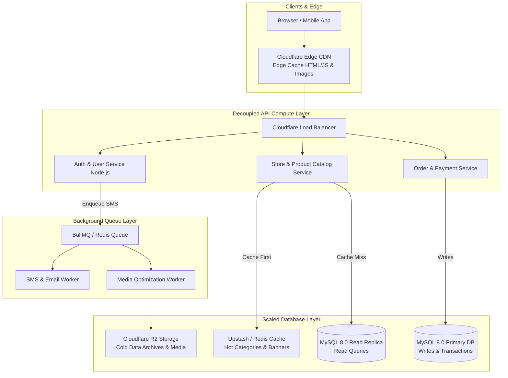

# Enterprise Scaling Roadmap (Growth to 100K+ Users & 500GB+ DB)
**Application**: Adilabad Application (`AdilabadBackEnd` & `AdilabadFrontEnd`)

This document outlines the technical architecture considerations, caching strategies, database sharding, and microservices decomposition required to scale the Adilabad application beyond initial startup tier (25K MAU) up to **100,000+ Monthly Active Users** and **500 GB+ Database Datasets**.

---

## 🚀 Scaling Architecture Overview



---

## 1. Database Scaling Strategies (500GB to 1TB+)

### A. Redis Caching Layer (Eliminate 80% DB Read Queries)
Currently, every homepage load executes `SELECT * FROM banner` and `SELECT * FROM category`.
* **Strategy**: Cache hot read datasets in **Redis** (e.g. Upstash Redis / Redis Cloud free/cheap tier) with a 1-hour Time-To-Live (TTL).
* **Implementation**:
  ```javascript
  async function getActiveCategories() {
      const cached = await redis.get('categories:active');
      if (cached) return JSON.parse(cached);

      const categories = await db.query('SELECT * FROM category WHERE status = 1');
      await redis.set('categories:active', JSON.stringify(categories), 'EX', 3600);
      return categories;
  }
  ```
* **Impact**: Database read load drops by **80%**, allowing 24GB RAM MySQL to handle 10x higher user concurrency.

### B. MySQL Primary-Replica Read/Write Splitting
When write traffic grows:
* **Primary Database (Write-Only)**: Handles `INSERT`, `UPDATE`, `DELETE` transactions.
* **Read Replica Databases (Read-Only)**: Asynchronous replication from Primary. All `SELECT` search queries route to Read Replicas.

### C. MySQL Table Range Partitioning
For large tables (`orders`, `activity_logs`), apply MySQL Range Partitioning by year/month:
```sql
ALTER TABLE orders PARTITION BY RANGE (YEAR(created_at)) (
    PARTITION p2024 VALUES LESS THAN (2025),
    PARTITION p2025 VALUES LESS THAN (2026),
    PARTITION p_future VALUES LESS THAN MAXVALUE
);
```
* **Benefit**: Queries filtering by date prune unused partitions instantly, bypassing 90% of disk I/O.

---

## 2. Asynchronous Background Job Queues (BullMQ + Redis)

### Current Bottleneck
Currently, Fast2SMS API calls execute synchronously inside HTTP request handlers. If the Fast2SMS gateway takes 3 seconds to respond, the end user's browser waits 3 seconds.

### Scaled Architecture
Use **BullMQ** to process heavy tasks asynchronously in background worker threads:
1. HTTP request enqueues job to Redis in `<5ms`: `await smsQueue.add('sendOTP', { phone, otp });`.
2. HTTP endpoint immediately returns HTTP 200 to user.
3. Background Worker picks up job from queue and handles SMS retries/rate-limits out-of-band.

---

## 3. Image & Media Optimization at Scale

1. **On-the-Fly Dynamic Resizing**: Replace fixed-width client image uploads with Cloudflare Image Resizing / Cloudflare R2 Edge Transforms.
   - Mobile screen receives `300px WebP` (15 KB).
   - Desktop Retina receives `1000px AVIF` (60 KB).
2. **Cold Media Archiving**: Automatically move store logos/banners inactive for >12 months to Glacier/Archive storage ($0.0026/GB).

---

## 4. Microservices Decomposition Roadmap

When team size grows beyond 5 engineers, decouple monolithic Express API into 3 microservices:

```
                  [API Gateway / Cloudflare]
                              │
         ┌────────────────────┼────────────────────┐
         ▼                    ▼                    ▼
[Auth Service]      [Catalog Service]    [Orders & Payments]
(Port 5001)          (Port 5002)          (Port 5003)
```

---

## 5. Observability, APM & Load Testing

1. **Error Tracking (Sentry)**: Integrate Sentry SDK in Frontend and Backend to capture real-time uncaught JS exceptions and stack traces before users report them.
2. **APM & Slow Query Log**: Enable MySQL `slow_query_log = 1` with `long_query_time = 1` (logs queries taking >1.0 second).
3. **Load Testing (k6)**: Run `k6` load scripts simulating 1,000 concurrent virtual users to verify throughput limits prior to major marketing campaigns:
   ```bash
   k6 run --vus 1000 --duration 5m load_test.js
   ```

---

## Summary Sizing & SMT Growth Matrix

| User Scale | Monthly Active Users | Recommended DB Setup | Media Strategy | Estimated Cost |
| :--- | :---: | :--- | :--- | :---: |
| **Startup Phase** | Up to 25,000 | Oracle Always Free VM (24GB RAM, 180GB SSD) | Cloudflare R2 / Oracle Storage | **$0 - $3.57 / mo** |
| **Growth Phase** | 25,000 - 100,000 | Oracle VM + Redis Cache (Upstash) | Cloudflare R2 + WebP Sharp | **$5 - $15 / mo** |
| **Enterprise Scale** | 100,000+ | MySQL Primary + 2 Read Replicas + Redis | R2 + Cloudflare Image Transforms | **$35 - $75 / mo** |
